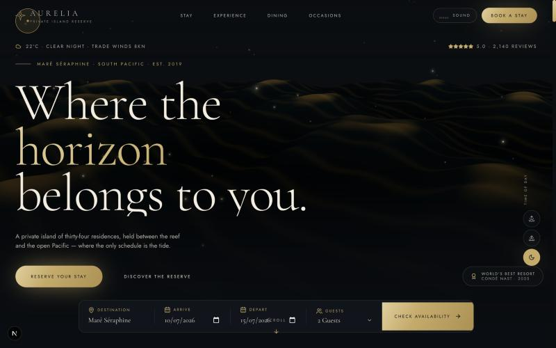

# AURELIA — Private Island Reserve

> _Where the horizon belongs to you._

A cinematic, award-targeted marketing experience for a fictional ultra-luxury
private-island resort. Built as a real, production-ready Next.js 15 application —
not a template, not a mockup.

**🔗 Live demo:** https://aurelia-reserve.vercel.app
<!-- ^ Replace with your own deployment URL (e.g. your Vercel domain). -->



---

## The brand

**AURELIA** is an invented ultra-luxury reserve on the fictional isle of **Maré
Séraphine** in the South Pacific — 34 overwater and beachfront residences, a
two-Michelin-star kitchen (_Maré_), an overwater spa, a private marina, a
helipad and a living coral reef. Every word of copy in the project is bespoke.

- **Palette** — deep tidal ink, champagne gold, warm ivory sand, muted sea.
- **Type** — _Cormorant Garamond_ (editorial serif display) + _Jost_ (geometric sans).
- **Voice** — restrained, exact, cinematic. Luxury as space, silence and time.

---

## Tech stack

| Area | Choice |
| --- | --- |
| Framework | **Next.js 15** (App Router, RSC) |
| Language | **TypeScript** (strict) |
| Styling | **Tailwind CSS** + custom design tokens |
| 3D / WebGL | **Three.js**, **React Three Fiber**, **Drei** (custom ocean shader) |
| Animation | **GSAP** + **ScrollTrigger**, **Framer Motion** |
| Smooth scroll | **Lenis** (wired into the GSAP ticker) |
| Carousel | **Embla Carousel** |
| Forms | **React Hook Form** + **Zod** |
| Counters | **React CountUp** |
| Icons | **Lucide** |
| Sound | Web Audio API (synthesised ocean ambience — zero audio assets) |

---

## Signature experiences

- **Preloader** — gold-dust particle canvas, letter-by-letter wordmark, elegant
  percentage counter and a two-panel curtain reveal (once per session).
- **Hero** — full-viewport R3F scene: a custom GLSL night-ocean with layered
  waves, drifting gold sparkles, fog depth and mouse-reactive camera parallax.
- **Custom cursor** — a gold dot + easing ring with contextual labels.
- **Lenis smooth scroll** synchronised with GSAP ScrollTrigger.
- **Pinned horizontal scroll** experiences gallery (GSAP).
- **Page transitions**, magnetic buttons, word/character mask reveals,
  parallax imagery, animated counters, a filterable masonry **gallery + custom
  lightbox**, and a synthesised **ambient sound** toggle.
- **Best-in-class booking wizard** — multi-step, live pricing, Zod-validated,
  animated confirmation.
- **AI Concierge** UI, **Guest dashboard**, and an **Admin panel** with
  hand-rolled SVG charts.

---

## Pages

`/` home · `/about` · `/rooms` · `/suites` · `/villas` · `/dining` · `/spa` ·
`/wellness` · `/experiences` · `/beach` · `/gallery` · `/offers` · `/events` ·
`/weddings` · `/meetings` · `/concierge` · `/booking` · `/guest` · `/admin` ·
`/blog` + `/blog/[slug]` · `/careers` · `/faq` · `/contact` · `/privacy` ·
`/terms` · `not-found (404)`.

---

## Project structure

```
src/
├── app/                 # App Router routes (one folder per page) + SEO files
│   ├── layout.tsx       # fonts, metadata, JSON-LD, <SiteShell>
│   ├── globals.css      # design system + luxury utility classes
│   ├── sitemap.ts / robots.ts / manifest.ts / not-found.tsx
│   └── <route>/page.tsx
├── components/
│   ├── booking/         # HeroBookingWidget, BookingWizard
│   ├── cards/           # RoomCard, ExperienceCard, SpecList
│   ├── concierge/       # ConciergeUI
│   ├── dashboard/       # GuestDashboard, AdminDashboard, MiniCharts (SVG)
│   ├── dining/          # MenuList
│   ├── experience/      # Preloader, PageTransition, ScrollProgress, SoundToggle
│   ├── gallery/         # GalleryGrid (+ lightbox)
│   ├── layout/          # Navbar (mega-menu), Footer, Logo, PageHero, SiteShell
│   ├── providers/       # SmoothScroll (Lenis), AmbienceProvider (Web Audio)
│   ├── three/           # HeroScene, OceanShader (GLSL)
│   └── ui/              # Button, Reveal, AnimatedText, Primitives, Accordion,
│                        #   MagneticButton, CustomCursor
├── hooks/               # useGSAP, media/pointer/scroll hooks
├── lib/                 # site.ts (content bible + types), utils.ts
└── sections/home/       # 14 hand-built home sections
```

---

## Running locally

```bash
npm install
npm run dev        # http://localhost:3000
npm run build      # production build
npm run start      # serve the production build
```

> This repo was built in an environment without a system Node install; Node 22
> LTS was installed locally under `~/.local/node`. Any recent Node 18.18+/20+/22
> will run it.

---

## Images

All photography is served **locally** from `public/images` — the site carries no
runtime dependency on a remote image CDN.

- Each photo is downloaded once, resized to a 1920px master and re-encoded as a
  progressive MozJPEG by [`scripts/build-local-images.mjs`](scripts/build-local-images.mjs).
- The same script emits [`src/lib/image-manifest.ts`](src/lib/image-manifest.ts)
  (intrinsic width/height + a base64 blur placeholder per image) and
  [`public/images/CREDITS.md`](public/images/CREDITS.md) documenting every source.
- [`src/components/ui/SmartImage.tsx`](src/components/ui/SmartImage.tsx) is a thin
  `next/image` wrapper that auto-attaches the `blur` placeholder from the manifest,
  so every photo renders with a width/height **and** a blur-up.

```bash
node scripts/build-local-images.mjs    # (re)fetch + optimise + regenerate manifest
node scripts/rewrite-image-urls.mjs    # swap any remote URLs for local paths
```

---

## Accessibility & performance

- Semantic landmarks (single `<main>`), a skip-link, `:focus-visible` styling and
  ARIA labels / `aria-pressed` on every icon-only control.
- Full `prefers-reduced-motion` support — the WebGL ocean and scroll effects
  degrade to a static, tasteful still.
- **3D hero** is lazy and defensive: the Three.js/R3F canvas lives in its own
  chunk, mounts only on capable devices **after the browser is idle**, caps the
  device pixel ratio (≤ 1.5) with an adaptive performance monitor, and explicitly
  disposes its GPU resources on unmount. Reduced-motion **and** low-power /
  Save-Data devices skip it entirely and get a server-rendered still (the hero LCP
  image).
- `next/image` (AVIF/WebP) everywhere, local blur placeholders, font
  `display: swap`, GPU-friendly transforms.
- Complete SEO: per-page metadata, a local OpenGraph/Twitter card (`/og.jpg`),
  `Resort` JSON-LD, sitemap, robots, manifest and an SVG favicon.

---

_Fictional brand created for demonstration. Photography via [Unsplash](https://unsplash.com/license)
(free license) — see [`public/images/CREDITS.md`](public/images/CREDITS.md)._
